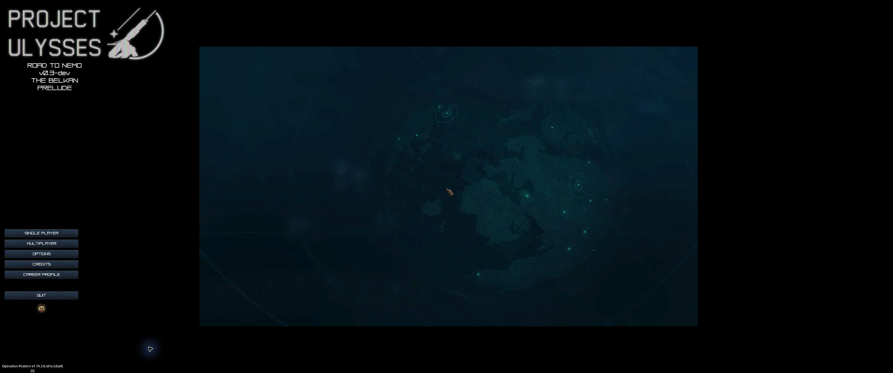
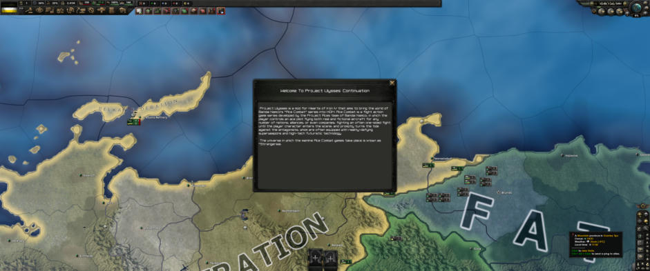

# PROJECT ULYSSES: ROAD TO NEMO

### THE BELKAN PRELUDE · v0.3-dev

**A Strangereal grand-strategy campaign for Hearts of Iron IV 1.19.3 “Operation Postern”**

`UNOFFICIAL CONTINUATION` · `1 JANUARY 1991` · `PRELUDE TO THE BELKAN WAR`

---

> **[ STRANGEREAL ARCHIVE // 01 JANUARY 1991 ]**
>
> The history books know how the Belkan War ended. They have yet to record how it began.
>
> **AWACS:** All stations, check your instruments. The frontier is quiet. That does not mean it is at peace.

## ▌ BEFORE THE SKY CAUGHT FIRE

**Strangereal. January 1, 1991.**

The Republic of Ustio and the Republic of Gebet have already broken away from Belka. Across the Osean continent, rival governments face unresolved borders, financial uncertainty and the growing weight of military power. The next few years will bring territorial concessions, political upheaval and, eventually, the Belkan War.

Far beyond the continent, another crisis approaches. The asteroid Ulysses will be discovered in 1994, and the catastrophe of 1999 will alter the course of Strangereal history.

**The campaign begins before those events. What happens next is the point of the game.**

**Project Ulysses: Road to Nemo** is an unofficial continuation of the original *Project Ulysses* Hearts of Iron IV total conversion. It preserves the original Strangereal map, country content, events and distinctive presentation while repairing the April 2024 open alpha (v0.2, *Under Our Treads*) for modern HOI4. The long-term ambition is a coherent historical and alternate-history campaign, beginning with the Belkan crisis and extending into later eras of Strangereal.

**Current reality:** the 1991 opening has passed an initial live runtime test on HOI4 1.19.3. The complete Belkan War, its alternate outcomes, the postwar years and later conflicts are **not yet finished or fully validated**.

**Anea expansion candidate:** Emmeria and Estovakia now have authored 1991–2005
campaigns with 54 focuses each, complete starting-country setups, renewable aid
and reconstruction choices, and original artwork. See the
[implementation and source ledger](docs/ANEA_EXPANSION_LEDGER.md),
[artwork gallery](docs/evidence/anea/artwork-gallery.html), and
[acceptance record](docs/evidence/anea/ACCEPTANCE.md). This candidate has static
and offline evidence; its native HOI4, AI, pacing and save/load acceptance remain
open. The historical runtime statements elsewhere describe their earlier builds.

### Historical coordinates

These are reference points from the [official ACES Chronicle](https://acecombat.jp/en/chronicle/details/), **not** a claim that every event is currently implemented or that an alternate-history playthrough must reproduce them.

| Year | The world outside the cockpit |
|---|---|
| **1988** | Gebet and Ustio gain independence from Belka. |
| **1991** | The Great Lakes Resource Development Company losses come to light; Belka cedes or sells further territory. |
| **1992** | The Belkan Liberal Democratic Party wins a single-party majority. |
| **1994** | Asteroid 1994XF04 is discovered; the threat of Ulysses becomes known. |
| **1995** | The Belkan War begins on **March 25**. |
| **1999** | Ulysses enters Earth's Roche limit, with consequences felt far beyond the impact zones. |

The **January 1991 bookmark is a prewar starting point**, not the canonical date of the Belkan War. Inherited mod content may differ from official chronology; such differences are to be documented rather than silently presented as canon. See the [canon policy](docs/CANON_POLICY.md) and [source ledger](docs/CANON_LEDGER.md).

---

## ▌ OPERATION BRIEFING

| Field | Assignment |
|---|---|
| **Operation** | **The Belkan Prelude** — continuation beta v0.3-dev |
| **Theater** | Osean continent and Belkan frontier, Strangereal |
| **Deployment** | **1 January 1991**, original bookmark: *The Ring of Time* |
| **Engine** | Hearts of Iron IV **1.19.3** (*Operation Postern*) |
| **Current status** | **INITIAL FLIGHT TEST PASSED** — Belka test campaign advanced through February 1992 without a crash |
| **Immediate mission** | Stabilize the 1991 opening: AI, orders of battle, references, presentation and campaign branches |
| **Long-term mission** | Carry historical and alternate outcomes through the Belkan War, postwar years and later Strangereal conflicts |
| **Campaign horizon** | **31 December 2065** is an engineering target, **not** a claim of completed playable content |

### Nations and organizations in the theater

These entries describe **inherited focus and event content**, not a guarantee that every branch is currently reachable or balanced.

| Country / organization | Inherited content |
|---|---|
| **Belkan Federation** | Opening, elections, DLP, victory and defeat focus branches, civil-war decisions and superevents |
| **Republic of Ustio** | Shared national-focus content and decisions |
| **Kingdom of Sapin** | Prewar focus tree, balance of power and national ideas |
| **Republic of Gebet** | Prewar focus tree and decisions |
| **Osean Federation** | Prewar focuses, Congress interface and election content |
| **A World With No Boundaries** *(faction)* | Shared focus content tied to the movement |

Other Strangereal nations can be selected using the generic focus tree. Historical squadron callsigns are deliberately not used as country names: Galm, Wardog, Gelb, Espada and Pixy belong to particular people, units or periods, not to the states themselves.

---

## ▌ AFTER-ACTION REPORT: THE 1.19 PORT

The original alpha targeted HOI4 1.13/1.14; on 1.19 it could crash at the menu and fail to load its map. The first continuation milestone restores the original Project Ulysses presentation and makes the 1991 campaign launchable.

**Observed live test (17 October 2026):** Belka, 1 January 1991 through February 1992 at speed 5, with no crash. This was an **initial smoke test**, not an endorsement of complete scenario balance, event reachability or long-run stability.

| System | What was checked |
|---|---|
| **Front end** | Original animated-globe menu and Project Ulysses identity restored; original country and scenario selection display |
| **Strangereal map** | Map loads; weather provided for all 326 strategic regions; river palette and 1.19 building positions repaired |
| **Technology** | Original modern-era technology tabs render and can be selected |
| **National focuses** | Inherited trees render; 1.19 continuous-focus interface available |
| **Doctrines** | Adapted to the newer grand-doctrine system, with initial doctrines assigned to major campaign powers |
| **Experimental Facilities** | Modern special-projects tab appears; **Strangereal superweapon replacements remain future work** |
| **Engine migration** | Leader abilities, modifiers and building definitions adapted for 1.19 |
| **Crash-risk warnings** | Warnings flagged “will most likely crash the game” decreased from **24 to 2** in the recorded test logs |

**This does not mean the error log is clean.** The [port log](docs/PORT_1_19.md) records remaining mod and inherited vanilla-reference errors, and the [testing checklist](docs/TESTING_CHECKLIST.md) tracks broader acceptance.

---

## ▌ KNOWN BOGEYS

- **Visual parity:** vanilla WWII imagery remains in some doctrine, continuous-focus, building, technology and special-project slots. The goal is *Strangereal art on every player-visible screen*, not a claim that the goal has been reached.
- **Inherited engine errors:** vanilla Earth-country content still references removed tags and equipment. These errors need investigation and targeted overrides, not blanket assumptions that they are harmless.
- **AI doctrine and division design:** inherited division templates use obsolete syntax; subdoctrine effects need tuning for the mod's modern units.
- **Scenario setup and history:** duplicate 1991 bookmarks, invalid ship-name groups, equipment icons, aircraft variants and a duplicate unit ID remain on the task list.
- **Branch continuity:** some Belkan outcomes still lead to the original demo-ending event (`world_event.2`); a working postwar campaign is not yet established.
- **Long-run validation:** the 1995 milestone, later conflicts, save/load checkpoints and the proposed 2065 horizon still require substantive gameplay tests.

[Prioritized tasks](docs/NEXT_TASKS.md) · [Port investigation](docs/PORT_1_19.md) · [Content inventory](docs/CONTENT_INVENTORY.md)

---

## ▌ FLIGHT PLAN

| Stage | Assignment | State |
|---|---|---|
| **Phase 0** | Preserve the source baseline and make the 1991 campaign boot on 1.19 | **Initial runtime milestone completed** |
| **Phase 1** | Stabilize the Belkan opening, orders of battle, AI, focus/event references and historical progression | In progress |
| **Phase 1b** | Replace remaining vanilla visuals with Strangereal assets | Planned / auditing |
| **Phase 2** | Replace the demo-ending handoff with functioning, distinct Belkan victory, defeat and postwar paths | Planned |
| **Phase 3** | Expand into Usea, Yuktobania, Erusea and later conflicts; develop Strangereal special projects | Planned |
| **Long-range** | Test meaningful continuation toward the inclusive 2065 campaign limit | Design target only |

Candidate superweapon systems include **Excalibur, V2, Stonehenge, Megalith and Arkbird**. Their presence in the plan **does not** imply that the corresponding 1.19 special projects have been implemented.

> **[ AWACS ]** First we make the opening sortie fly. Then we decide where history goes.

[Development phases](docs/PHASED_PLAN.md) · [Implementation roadmap](docs/ROADMAP.md) · [Design contract](docs/DESIGN.md)

---

## ▌ SORTIE PROCEDURE

This is a **development build**, not a packaged release.

1. Place `mod/2985041246/` in `Documents\Paradox Interactive\Hearts of Iron IV\mod\`, or use a development descriptor that points at this checkout. See the [workspace instructions](docs/WORKSPACE.md).
2. Place the `mod/2985041246.mod` descriptor in the same mod directory, and ensure its path resolves to the installed mod folder.
3. In the launcher, enable **Project Ulysses: Road to Nemo** in a **dedicated playset**. Do **not** enable it alongside another total conversion.
4. Start **Single Player → New Game → 1 January 1991**, select a nation and launch the campaign.

> **[ AWACS ]** The mod replaces the map, history, country setup, AI templates and much of the presentation. Keep a separate playset and preserve existing saves.

---

## ▌ ENGINEERING HANGAR

**Authored aftermath expansion — The Peace We Inherit:** 58 additional focuses
connect Belka's victory, Wacht am Wal and defeat to political programs, recovery
and diplomacy with Osea, Ustio, Sapin and Gebet. Preparedness choices lead into
the 1999 Ulysses relief assessment. [Content and source ledger](docs/PEACE_WE_INHERIT.md).
The package has offline/static transition coverage; native gameplay, rendering,
save/load, AI progression and balance remain unverified.

**Compatibility:** HOI4 1.19 mechanics are welcome; Earth/WWII artwork is not. New doctrines, experimental facilities and building types must fit the setting rather than remain visible as vanilla placeholders.

**Experimental economy:** a separately developed, default-off [fiscal prototype](docs/ECONOMY.md) covers budgets, treasury, bounded debt and basic procurement. Its coefficients are provisional gameplay abstractions, **not canonical Strangereal economic data**. Offline/static checks do **not** establish that it has passed HOI4 native runtime and integration tests. [Provenance and attribution](docs/ECONOMY_PROVENANCE.md).

**Developer workspace:** [Project-Ulysses.code-workspace](Project-Ulysses.code-workspace) provides portable VS Code tasks for manual validation. See [IDE workspace setup](docs/IDE_WORKSPACE.md). Antigravity operation has not been verified.

**Continuity:** official Project Aces source material, original Project Ulysses mod provenance, user-authored continuity and provisional mechanics are tracked as **different source layers**. New branches should not invent official canon to fill the planned 2065 timeline.

### Intel archive

| Document | Purpose |
|---|---|
| [1.19 port log](docs/PORT_1_19.md) | Tested compatibility changes and outstanding issues |
| [Workspace](docs/WORKSPACE.md) | Local layout, source archive evidence and isolated test playset |
| [Phased plan](docs/PHASED_PLAN.md) | Development gates and exit criteria |
| [Next tasks](docs/NEXT_TASKS.md) | Prioritized engineering work |
| [Content inventory](docs/CONTENT_INVENTORY.md) | Inherited events, focus files, map and placeholders |
| [Canon policy](docs/CANON_POLICY.md) / [canon ledger](docs/CANON_LEDGER.md) | Official sources vs. inherited, authored and provisional material |
| [Compatibility checklist](docs/COMPATIBILITY_CHECKLIST.md) | Static compatibility requirements |
| [Testing checklist](docs/TESTING_CHECKLIST.md) | Runtime evidence and open acceptance tests |

---

### ▌ DEBRIEFING

*Original Project Ulysses by the Project Ulysses Development Team. All original-team credit remains with its creators.*

*This continuation is private, unofficial and fan-made. ACE COMBAT and Strangereal are properties of Bandai Namco Entertainment and Project Aces. Not affiliated with or endorsed by the original mod team, Bandai Namco, Project Aces or Paradox Interactive.*

**`MISSION STATUS: THE BELKAN PRELUDE · INITIAL FLIGHT TEST PASSED · DEVELOPMENT CONTINUES`**

