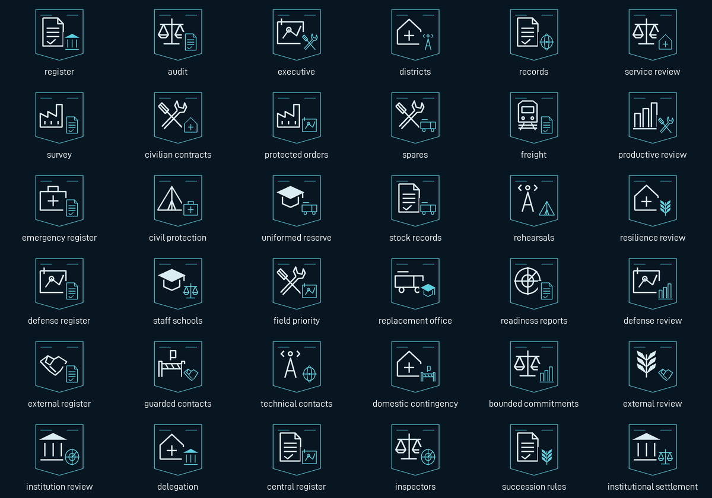

# National institutions and the regional foundation programme

This package adds an institutional gameplay layer for the **69 existing country
histories**, **21 national administrative choices**, and one persistent
**36-focus regional tree** for the **56 countries without dedicated trees**.
It preserves the existing leaders, ideological identities, national campaigns,
war owners and old generic-focus definitions. This is a partial playable
foundation: political decisions do not establish that every country has a
complete economy, roster, logistics network or bespoke history.

Source implementation and offline tests are complete in this package. Native
parsing, save serialization, visual interaction, AI selection and balance remain
unverified. No native game, installation synchronization or user-save operation
is part of this work.

## Provenance and boundaries

The [69-row profile manifest](../tools/institutions/profiles.json) records each
tag, exact country-history path, inherited party, source SHA-256, institutional
model, tree disposition and implementation status. Its reference point is
`main` at `3810d1a`. This preserves archive/repository context as **mod provenance**;
the form names, capacity values, policies, decisions and all new focus rewards
are **provisional gameplay**. A ruling party is not proof of a constitutional
form. None of these profiles establishes an official presidency, legislature,
monarchy, military government, term, biography or future historical event.

The model distinguishes civil administration, executive offices, crown offices,
party secretariats, command administration and council offices. These are delivery
models rather than a universal legislature. The country-selection office leaders
and established characters are not edited or replaced.

Each model also has its own paid 180-day service programme: an administrative
hearing, interdepartmental allocation, crown service conference, production
secretariat review, readiness allocation board or council service rotation.
They cost 25 political power and 3–5 capacity, have different capability/cost
spirits and share a 180-day cooldown. The model refreshes against the current
inherited government type without changing that government; the AWW and RAT
council contexts remain explicit mod-provenance exceptions.

The implementation adds no borders, cores, country tags, factions, forced
alignment, war declarations, strategic weapons, starting factories, equipment,
military units or resource claims. State 171 and unrelated `XXX` geography remain
outside its scope. It writes no `ac_ucw_`, `ac_pwi_`, `ac_anea_` or fiscal-owned
variable. It does not adopt another campaign's audited-distribution, preparedness,
ISAF-hosting, refugee-policy or command-reform outcome by analogy.

## Capacity, policies and paid work

Institutional capacity starts at **40**, is clamped to **0–100**, and initializes
once for an existing profiled country with owned territory. The same baseline
introduces the new measure in eligible old saves; there is no historical event,
preparation payout or country-history setup grant. Late initialization is flagged
from 8 January 1991 and never reseeds a saved value.

Only one framework mandate can be active:

| Mandate | Enduring capability and cost | Capacity cost |
| --- | --- | --- |
| Public administrative | Civilian factory construction +4%; military factory construction −4%; political power gain −0.05/day | 1/week |
| Protected delivery | Military factory output +3%; civilian factory construction −5%; political power gain −0.05/day | 2/week |
| District service | Stability +3%; political power gain −0.08/day | 1/week |

Adoption costs **30 political power and 10 capacity**, replaces the previous
framework mandate and has a **180-day cooldown**. Repeated calls, stale decision
actions and calls with insufficient resources cannot pay twice. At zero capacity
the mandate suspends, its positive effects end, and an administrative-suspension
spirit costs 0.03 political power/day. A new mandate never resumes automatically.
The weekly owner has a six-day payment guard against repeated execution/reload
within the same weekly interval.

The scheduler uses the engine's country-scoped `on_weekly` callback, guarded by
the original-tag profile. This includes a temporary civil-war country with a
different current tag. Literal original-country weekly hooks would leave that
identity without mandate charges, review repair or fiscal synchronization.

Normal domestic programmes share a **90-day cooldown**, cost **25 political
power**, and reserve civilian construction attention for 90 days (−3% building
construction). Their different continuing uses are:

| Programme | Capacity | Additional result | Unlock |
| --- | ---: | --- | --- |
| Administrative audit | 12 | — | Available on initialization |
| Public records | 8 | +1% stability | Regional records capability |
| Maintenance staffing | 6 | +2 army experience | Productive survey |
| Domestic relief | 8 | +1% stability | Essential-service register |
| Replacement staff exercise | 4 | +4 army experience | Defense register |
| Technical-contact duties | 6 | +2 air experience | External-commitment register |

Below 15 capacity, a separate limited service review costs **10 political power**,
reserves construction attention for 90 days and restores **6 capacity**, on its
own 90-day cooldown. This gives a useful recovery route after suspension or a
refused national mandate. It does not refund prior costs or restart the policy.

These are provisional calibration values. In particular, military delivery can
consume administrative capacity faster than routine audits can restore it;
players must choose how long to protect it and whether to suspend it. The source
does not establish natural AI pacing or balanced macroeconomic outcomes.

## Country-specific administrative choices

Each priority country has a once-only national review with two substantive
administrative allocations and a deferral option. Its own event revalidates the
country, initialization, capitulation status, pending review and unresolved
outcome; its choice effect rechecks the relevant condition. The national spirit
has a continuing political or construction opportunity cost. Completing a review
adds 5 capacity once. Merely opening or deferring one pays no reward; a deferred
review can reopen after 90 days while paid domestic work remains available.

Pending reviews have a 30-day response window. The weekly owner cancels an
invalidated or expired pending review without a reward, so capitulation,
annexation before event delivery, an undelivered event or an unanswered dialog
cannot permanently strand the review after restoration. Replies recheck the
live response window; a later stale dialog cannot pay the choice twice.

The [authoring rows](../tools/institutions/content.py) hold the complete narrative,
two alternatives and eligibility conditions. They intentionally distinguish:

| Country | Administrative issue | Conditional first route / continuing fallback |
| --- | --- | --- |
| San Salvacion | Civilian continuity | Peacetime public accounts / constrained service reserve |
| Amber | Coalition procurement | Independent common accounts / domestic replacement work |
| Ugellas | Transport allocation | Peacetime freight accounts / protected freight reserve |
| Delarus | Staffing commitments | Independent technical review / existing service duties |
| Osea | Civil authority and readiness | Peacetime procurement review / replacement mandate |
| Yuktobania | Technical administration | Peacetime inspection / command delivery reserve |
| Erusea | Administrative inventory | Peacetime ministry reconciliation / delivery directorates |
| Central Usea | Common and national accounts | Independent common audit / ministry capacity |
| Emmeria | Assistance ceiling | Peacetime civilian oversight / domestic service ceiling |
| Estovakia | Distribution responsibility | Peacetime inspection staffing / command distribution staff |
| North Point | Island service priorities | Peacetime service coordination / readiness staff |
| Recta | Reconstruction records | Peacetime public accounts / protected recovery staff |
| Sapin | Crown and public service | Existing monarchy's review offices / technical secretariat |
| Gebet | Industrial accountability | Peacetime inspection / secure supply planning |
| FATO | Administration under constraint | Independent review / surviving administration |
| South Belka | Surviving service offices | Independent public accounts / continuity within actual authority |
| Nordennavic | Scope of consultation | Independent peacetime consultation / national technical reserve |
| Aurelia | Services and technical capacity | Peacetime civilian review / preparedness staff |
| Leasath | Procurement priorities | Peacetime contract review / compact delivery staff |
| Belka | Departments and public accounts | Independent peacetime accounts / surviving service mandate |
| Ustio | Authority and contracted expertise | Independent contracts / surviving administration |

The national choices are context, not alternate national focus trees. The 13
existing bespoke-country tree owners stay authoritative. FRU and DOR remain on
the regional framework without being presented as additional priority campaigns.

## Persistent regional tree and save continuity

The six branches cover administration, productive allocation, emergency services,
defense, external commitments and institutional continuity. Each has six focuses,
including exclusive alternatives: **36 definitions total**, normally 35 days,
with 70-day concluding commitments. Each major root opens an actual paid service
programme. Major allocations create enduring capability and an opportunity cost.
No chain adds interchangeable factories or political-power grants.

The new tree's selection factor is 5 only for profiled nonbespoke countries; all
13 bespoke tags are excluded. The inherited `generic_focus` and all 54 focuses
remain defined and unchanged. Existing generic-tree saves receive a visible
**Adopt the Regional Foundation Programme** decision. It is eligible only when
no normal or continuous generic focus is in progress and loads the new tree with
`keep_completed = yes`. The adoption effect rechecks eligibility and grants no
capacity, industry, equipment or historical preparation reward. It never swaps a
bespoke country's tree.

The regional content is continuing domestic policy rather than an expired dated
preparation chain. Concluding assessments have no upper date gate and remain
reachable after 2005 or 2020 when their prerequisite work actually finishes.

## Fiscal and campaign integration API

The framework works with fiscal simulation and faction councils disabled.
Political-power and construction costs always apply. With the full fiscal model
ready, the framework reserves annual commitments through **only**
`ac_macro_change_commitment`, guarded by `ac_macro_ready`:

- civic: 0.05% of nominal GDP annually;
- protected delivery: 0.10%;
- district service: 0.03%.

The applied amount is snapshotted in `ac_pol_fiscal_applied`. Replacement or
suspension reverses that exact snapshot before applying any new mandate amount;
subsequent GDP changes do not alter the reversal. A dirty flag defers reconciliation
while the optional owner is unavailable. The framework never spends treasury,
alters arrears, changes taxes or settles the fiscal calendar.

The receipt is bound to the engine country ID in `ac_pol_fiscal_identity`.
When a civil-war clone receives a new fiscal account, copied receipt bookkeeping
is discarded without subtracting from that new account's unrelated commitments.
The current mandate is then reserved once against the new account. Losing
readiness temporarily preserves an existing receipt for its exact later reversal;
it is not treated as a new account merely because the model is unavailable.

This branch declares a dependency on the Package 1 fiscal owner's public API.
Its isolated regression uses a read-only copy of the actual narrow commitment
effect in [fiscal_api_fixture.txt](../tools/institutions/fiscal_api_fixture.txt),
with quote recomputation stubbed at the API boundary. When the actual owner is
present in the integrated payload, the harness loads it instead. Full economic
settlement remains the economy owner's separate test responsibility. An isolated
institution-only payload must not be delivered as an integrated playable release.

Country campaigns may call this stable public interface:

```text
ac_pol_initialize = yes
if = {
    limit = { ac_pol_active = yes }
    set_temp_variable = { ac_pol_capacity_delta = -3 }
    ac_pol_change_capacity = yes
}
```

The caller owns its payment, once-only and cooldown conditions. Signed capacity
changes clamp through the institution owner and suspend an active mandate at
zero. Callers may read capacity for eligibility and UI, but must not write its
variables or policy flags. Initialization never takes over a war or faction owner.

## Original artwork and reproducibility

The [art source](../tools/institutions/build_art.py) and semantic motif rows are
editable code-native originals. The package supplies **36 distinct focus
compositions**, 63 matching spirit icons, one category icon and one deliberately
shared symbolic review card: **101 DDS assets / 102 sprite bindings**. Existing
national flags identify country-specific mandate icons; the manifest records each
flag's path/hash. There are no invented portraits, imported vanilla pixels or
claimed new narrative raster scenes.

[assets.json](../tools/institutions/assets.json) records dimensions, one-frame
layouts, alpha requirements, sprite bindings, semantic sources and DDS SHA-256.
Focus icons are 96×96, spirits 64×64, the category 100×100 and the review card
200×160. The icon aperture is transparent; the navy composition field is opaque.
The review card is fully opaque. DDS packaging uses uncompressed RGBA.



The gallery is an offline source preview, not native visual evidence. Generate
and verify from the repository root:

```powershell
python -m pip install Pillow==11.3.0
python -B tools/institutions/build.py
python -B tools/institutions/build_art.py
python -B tools/institutions/build.py --check
python -B tools/institutions/build_art.py --check
python -B tools/Test-Institutions.py
python -B tools/audit_visual_dependencies.py --strict-all
```

`--capture-profiles` deliberately refreshes the committed source manifest and
must be reviewed as a provenance change; ordinary generation never recaptures
country history. PNG gallery checking compares pixels across Pillow encoder
versions; DDS output and its hashes are checked exactly. Packaging requires the
same **Pillow 11.3.0** version as CI; 11.0.0 renders some filled leaf motifs
differently. The gallery uses the shipped original bitmap font atlas to avoid
platform FreeType differences.

## Acceptance still required

Offline coverage executes the shipped effects, triggers, decisions, events and
focus rewards; checks initialization/reload, bounds, costs, cooldowns, all national
reviews, refusal, invalidated options, suspension, fiscal reversal, legacy handoff,
late assessments, references, distinct artwork and generator output. It does not
run the engine, serialize HOI4 saves or establish pacing.

Native acceptance remains paused. When separately authorized, use an isolated
candidate payload and disposable profile. Check all six institutional contexts,
the 21 priority reviews, a regional country, a subject, interruption at zero
capacity, save/reload around weekly payments and handoff, and disabled/legacy/full
fiscal configurations. Check the regional tree and institution decisions at
3440×1440/1.0, 1920×1080/1.0 and 2560×1440/1.25, with natural progression beside
shortcut coverage. Keep the existing P0 interface and country-foundation
acceptance checklists separately visible.
