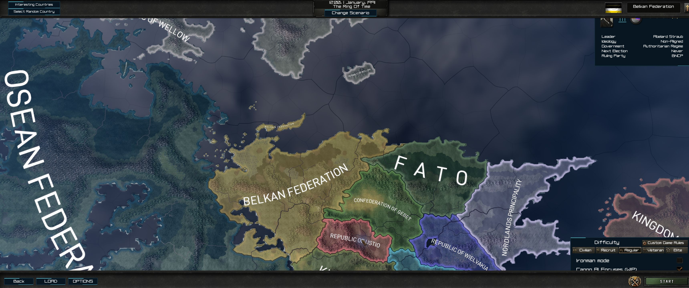

# Map lettering and Road to Nemo branding

## Reference and implementation

The visual reference requested on 24 October 2026 is
[Project Ulysses-Style Map GFX](https://steamcommunity.com/sharedfiles/filedetails/?id=3792227052)
by ErroredSys. The Workshop gallery was inspected directly: the country names
use solid white, regular-weight, narrow sans-serif lettering with restrained
spacing. The exact Workshop font file was not verified. This implementation
matches that appearance using an independently licensed font; it does not claim
an exact extraction or affiliation with the Workshop author.

The renderer's `gfx/fonts/hoi_mapfont4.fnt` and `.dds` paths now resolve to an
authored bitmap conversion of **DINish Regular 4.007**, under the SIL Open Font
License 1.1. This replaces the hollow/dark-filled country lettering with white
glyph interiors and antialiased coverage. Map-name placement and curvature remain
under the engine's existing fitting system.

| Input/output | Provenance |
| --- | --- |
| Workshop gallery | Visual reference only, item 3792227052, inspected 2026-10-24; no Workshop files imported |
| DINish source font | [Upstream release v4.007](https://github.com/playbeing/dinish/releases/tag/v4.007), commit `56416a590a5b4ef7f121d1c20cbbd173ebbfab51`, `fonts/ttf/DINish/DINish-Regular.ttf` |
| Source SHA-256 | `ad45d1b0d9da9597b82e587aa54590c3f571b4254ce0ef1db6daf318cc9cc278` |
| License and attribution | Unmodified upstream `OFL.txt` and `FONTLOG.txt`, bundled with both source and playable font output |
| Bitmap conversion | Generated family name **AC Map Briefing**, 465 glyphs, 2048×1024 legacy 32-bit BGRA DDS; generated independently of installed-game assets |
| Map geography and country names | Existing repository content; no changes and no new lore claims |

The source font credits are retained in full in `AC_MAP_FONTLOG.txt`. Latin
accents and basic Cyrillic, including Russian and Ukrainian sample characters,
are checked. Other scripts have only the glyph coverage provided in `font.json`;
this is not a claim of complete localization support.

Rebuild with `python tools/frontend_typography/build.py` (Pillow required).
Validate with `python tools/frontend_typography/validate.py` (standard library
only). The source TTF is pinned and bundled for offline reproducibility. The
generated atlas, metrics and license files rebuild byte-identically in the tested
environment. CI checks hashes, DDS format, glyph/page bounds, country-label
coverage, Latin/Cyrillic samples, licensing and active branding.

## Display branding

The existing project name in the README is **Project Ulysses: Road to Nemo**.
The main menu now displays:

```text
ROAD TO NEMO
v0.3-dev
THE BELKAN PRELUDE
```

The welcome heading and all three repository mod descriptor display names use
the same project title. The README's legacy title/instructions and the welcome
disclosure label are updated. The disclosure still identifies an unofficial
continuation and credits the original team. Stable localization identifiers,
mod folder names and historical reports retain their existing names.

## Static validation

The follow-up is based on `2695da6`, with `origin/main` verified at `1c36a33`.
The following commands passed on 24 October 2026:

```powershell
python tools/frontend_typography/validate.py
python tools/frontend_briefing/validate.py
./tools/Test-UlyssesStatic.ps1 -ModRoot "$PWD/mod/2985041246" -ReferenceGameRoot 'G:\steamlbirary\steamapps\common\Hearts of Iron IV' -BaselineRoot 'G:\Project-Ulysses-Continuation\source\baseline\2985041246'
git diff --check
```

- Typography: 465 glyphs, complete BGRA atlas, valid metrics, retained licenses,
  covered English country labels and consistent Road to Nemo display branding.
- Existing briefing checks: 44 textures, 59 sprites and 30 bindings pass, with
  original layout preserved.
- Full static suite: zero errors; two inherited map warnings, 2,011 reference
  warnings and one inherited technology warning. The no-vanilla audit finds
  zero new or path-independent vanilla copies; four inherited map configuration
  matches remain. The campaign horizon remains `2066.1.1.1`.
- Rebuilding the font twice produced byte-identical outputs.

The full static output is retained locally at
`G:\Project-Ulysses-Visual-20261024\evidence\typography-static.txt`.

## Native verification

HOI4 **1.19.3.0.c01a**, checksum **cba9**, DirectX 11, **3440×1440**, UI scale
**1.0**, loaded the disposable typography profile with exactly one active mod,
**Project Ulysses: Road to Nemo**. The main menu visibly renders the new title
and the existing Belkan Prelude subtitle. The subtitle wraps within the original
text area; no layout positions changed.


Single Player → New Game → scenario selection → Belka → Select Country reached
the map lobby. Country labels visibly use the delivered solid-white font, with
the engine retaining placement and curvature. Regional views at two camera zoom
positions showed Belka, Osea, FATO, Gebet, Ustio, Wellow and Nordlands, including
small island labels. No map-font errors were found in the isolated error log.



Back navigation returned to the main menu and Quit closed the game normally.
No campaign or normal save was loaded. This is native acceptance of these map
labels and the main-menu title at the tested resolution. The welcome heading
and repository launcher descriptor names were checked statically; other
languages, UI scales/resolutions and full aftermath campaign acceptance remain
outside this follow-up.

## Isolation and retained evidence

The disposable profile is `G:\Project-Ulysses-Typography-20261024\profile`.
It reuses the separate physical engine copy from the earlier native test; only
that copy's `userdir.txt` and `launcher-settings.json` were temporarily routed
to the new profile, then restored. The installed game's routing was not changed.
Normal saves, settings and playset files were outside the test profile.

The final SHA-256 audit verified **109 protected normal files** unchanged:
81 saves, eight configuration/launcher files and 20 logs. No normal saves were
added or removed, and the installed-game `userdir.txt` remains absent. All
**2,880 source and test-payload files** match, with no missing, extra or changed
payload files. This launch did not require restoring any normal-profile files.

Local screenshots, startup logs, source-payload parity and preservation audit
records are retained under `G:\Project-Ulysses-Typography-20261024`. The earlier
[frontend briefing report](FRONTEND_BRIEFING_REPAIR.md) remains a record of its
own tested revision and its separately documented diagnostic-launch restoration.
This typography follow-up does not expand that earlier report into an all-screen
visual acceptance claim.
